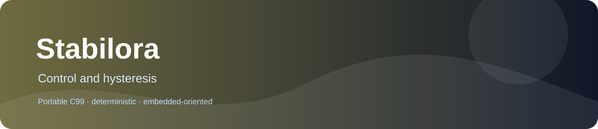

# Stabilora
  



Output clamping, debounce, dual-threshold qualification, histogram clipping, checked shifts, and capped timeout control.

## Why it exists

Digital inputs and actuator outputs need stable bounded transitions under noisy conditions.

## What is included

- Six independently linkable C99 functions in separate translation units.
- Deterministic integer behavior and explicit failure/output contracts.
- No mandatory heap, threads, operating-system services, or external libraries.
- A static CMake library and optional host tests.

## Quick start

```sh
cmake -S . -B build -DSTABILORA_BUILD_TESTS=ON -DSTABILORA_STRICT_WARNINGS=ON
cmake --build build --parallel
ctest --test-dir build --output-on-failure
```

For package integration, call `find_package(Stabilora CONFIG REQUIRED)` and link `Stabilora::Stabilora`. Tests are opt-in and off by default. For selective integration, include the operation header and compile its source file plus documented helper sources.

## Consume Stabilora

CMake package:

```cmake
find_package(Stabilora CONFIG REQUIRED)
target_link_libraries(your_target PRIVATE Stabilora::Stabilora)
```

`add_subdirectory()` is also supported. Both dependency paths need only a C compiler when `STABILORA_BUILD_TESTS=OFF` (the default). Enabling the optional tests also enables the C++ compiler for the header smoke test.

For direct C99 integration, include only the operation header and compile its matching source. `stabilora_timeout_backoff_cap_u32` also requires `src/stabilora_checked_shl_u32.c`.
## Documentation

| Need | Read |
|---|---|
| Choose a primitive | [Family guide](docs/FAMILY_GUIDE.md) |
| Check every function and contract | [API reference](docs/API_REFERENCE.md) |
| Review per-API findings | [Audit register](docs/AUDIT.md) |
| Reproduce tests and see validation limits | [Testing report](docs/TESTING.md) |
| Review design and dependencies | [Architecture](docs/ARCHITECTURE.md) |
| See measured or pending performance data | [Performance](docs/PERFORMANCE.md) |

## Validation status

Six of six public APIs have standalone test executables. Current GCC, ClangCL and MSVC Debug/Release validation is summarized in [TESTING.md](docs/TESTING.md). Historical ESP32-S3 evidence covers the six pre-productization APIs; current revision is HW NOT VERIFIED. Performance, isolated flash and RAM, and stack measurements have not been made.

## License

Apache License 2.0, copyright Vanderhell. See [LICENSE](LICENSE) and [NOTICE](NOTICE). Contribution guidance: [CONTRIBUTING.md](CONTRIBUTING.md). Security reporting: [SECURITY.md](SECURITY.md).
